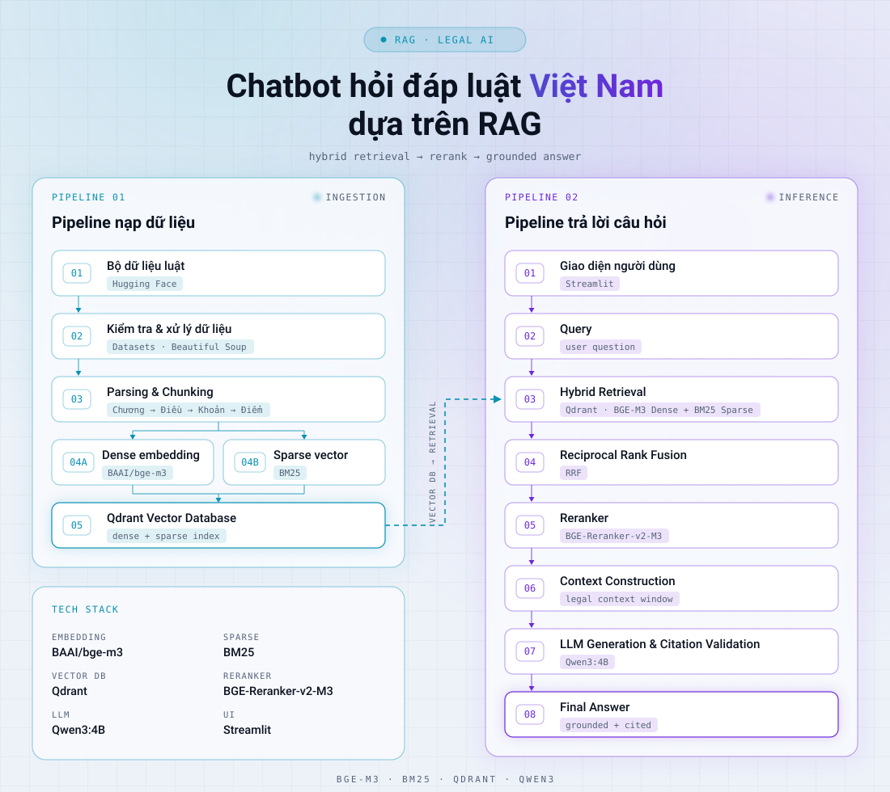

# Chatbot hỏi đáp luật Việt Nam dựa trên RAG

Chatbot hỏi đáp pháp luật Việt Nam sử dụng kiến trúc **Retrieval-Augmented Generation (RAG)**, giúp người dùng tra cứu và tìm kiếm các quy định pháp luật thông qua ngôn ngữ tự nhiên. Hệ thống kết hợp Hybrid Search và LLM để truy xuất tài liệu liên quan, sau đó tổng hợp câu trả lời dựa trên nguồn văn bản pháp luật.



## Tính năng

- Hỏi đáp các vấn đề pháp luật bằng ngôn ngữ tự nhiên.
- Tìm kiếm văn bản pháp luật bằng Hybrid Search, kết hợp ngữ nghĩa và từ khóa.
- Reranking kết quả truy xuất để cải thiện độ liên quan của tài liệu.
- Sinh câu trả lời dựa trên nội dung văn bản pháp luật được truy xuất.
- Hiển thị nguồn tham chiếu, hỗ trợ kiểm chứng thông tin.
- Hỗ trợ lọc và nhận diện tình trạng hiệu lực của văn bản pháp luật.

## Dữ liệu

Dataset được sử dụng: [th1nhng0/vietnamese-legal-documents](https://huggingface.co/datasets/th1nhng0/vietnamese-legal-documents) trên Hugging Face.

## Công nghệ sử dụng

| Thành phần | Công nghệ |
|---|---|
| Frontend | Streamlit |
| Retrieval | Qdrant Hybrid Search |
| Dense Vector | BGE-M3 |
| Sparse Retrieval | BM25 |
| Reranker | BGE-Reranker-v2-M3 |
| Vector Database | Qdrant |
| LLM | Ollama - Qwen3:4b |
| Programming Language | Python |

## Cấu trúc thư mục

```text
RAG/
│
├── explore_dataset/       # Kiểm tra và khám phá cấu trúc dataset
│
├── ingestion/             # Xử lý, chunking và nạp dữ liệu vào database
│
├── retrieval/             # Xử lý truy xuất tài liệu trước khi đưa vào LLM
│
├── app.py                 # File chính, khởi chạy giao diện Streamlit
│
└── README.md
```

## Cách chạy project

### 1. Khởi động Qdrant

Mở terminal và thực hiện:

```powershell
cd $HOME/qdrant
./qdrant.exe
```

Qdrant Server sẽ được khởi động trên máy local.

### 2. Chạy giao diện chatbot

Mở terminal tại thư mục gốc của project:

```bash
streamlit run app.py
```

### 3. Kiểm tra hiệu quả Retrieval

Chạy bộ đánh giá Retrieval:

```bash
python retrieval/eval_retrival.py
```

## Kết quả đánh giá Retrieval

Đánh giá trên tập dữ liệu gồm **201 câu hỏi**, sử dụng mức truy xuất **Điều**, với các tham số:

- K = 5
- RRF k = 2 (mặc định Qdrant)

| Phương pháp | Recall@5 | MRR | Hạng TB* |
|---|---:|---:|---:|
| Dense (BGE-M3) | 0.73 | 0.61 | 2.12 |
| Sparse (BM25) | 0.75 | 0.58 | 2.46 |
| Hybrid Search | 0.82 | 0.67 | 2.39 |
| Hybrid + Reranking | **0.85** | **0.80** | **1.46** |

*Hạng TB: Thứ hạng trung bình của tài liệu liên quan trong kết quả truy xuất.*

---

**Project:** Vietnamese Legal Q&A Chatbot  
**Architecture:** Retrieval-Augmented Generation (RAG)
